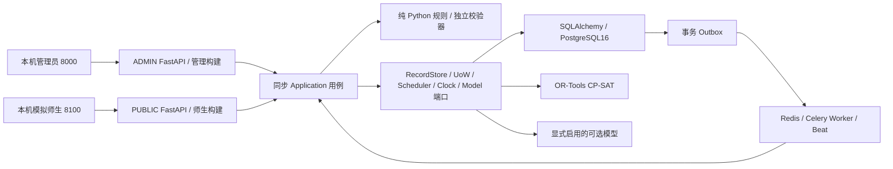

# 架构

EduFlow 保持模块化单体。两个 HTTP 应用复用同一组业务用例、数据库、求解器、Worker 与应用镜像；它们承担不同入口的认证和路由边界。

领域和应用不导入 FastAPI、SQLAlchemy、Celery、OR-Tools 或 Pydantic。认证、安全中间件、SQL、队列和模型是适配器；两个 HTTP 工厂在组合根组装。同步 SQLAlchemy / psycopg 与同步用例一致，耗时求解离开 HTTP 请求和长事务执行，保存前重查快照。

## 入口和权限

ADMIN 只接受管理员；PUBLIC 不注册 /admin API 且拒绝管理员登录和刷新。两端使用独立密钥文件、JWT audience / portal、不同刷新 Cookie 名称。浏览器仅在内存保存访问令牌，刷新 Cookie 为 HttpOnly / SameSite=Strict；本机 HTTP 不错误开启 Secure，隔离 HTTPS 开启并已实测。

身份选择不改变角色，所有查询、写入、Agent 工具继续执行机构与对象检查。可信 Host / Origin 按入口约束，转发头不作为身份依据。TEST 混合适配器只允许 *_test 数据库，不能作为演示或部署入口。

## 事务和排课

机构资源锁保护影响排课的业务写入，周锁保护发布与原子替换，revision 防止旧方案生效；通知已读不争用全局资源锁。列表分页在数据库执行，完整排课快照独立读取，避免分页截断求解输入。

逻辑课次 ID 跨版本稳定，记录 ID 随版本变化。教师、成员、时间、教室或状态变化会改变指纹，只有内容与确认指纹一致才继承确认。生效前重新计算必要确认集合，重查开始时间、基础 revision、规则与全部硬约束，在同一事务替换资源预订和有效版本。PostgreSQL 排他约束提供最后保护。

每个业务 Redis 实例的求解锁最多允许一个求解任务，其余排队；Worker 并发 2 为通知等轻任务留出处理余量。通知使用事务 Outbox，事件/用户去重，失败不回滚已提交业务，有限重试与提醒由现有 Beat 完成。

## 文件和运维

静态服务只允许构建资源和已知 SPA 路由，检查路径、扩展名与目录链接逃逸。详细诊断和原始证据留在 .runtime/private，HTTP 返回稳定错误码与请求编号。容器只挂备份所需目录，HTTP 无任意文件、系统命令或任意 URL 工具。

排课约束和工作流见 [排课规则](scheduling-rules.md) 与 [业务规则](business-rules.md)，可复现结果见 [验收报告](testing-report.md)。
