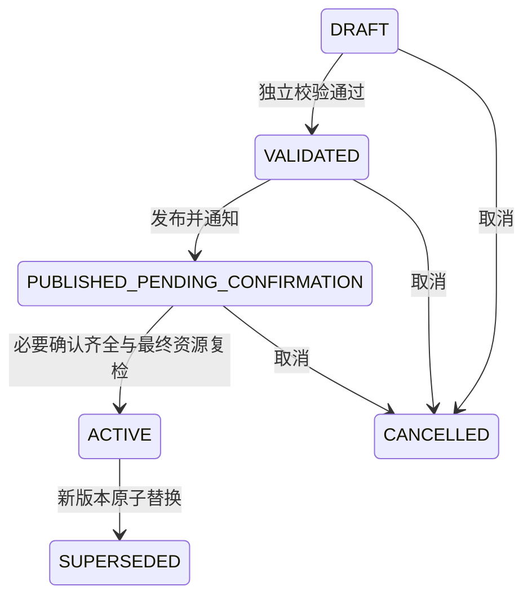

# 业务规则与状态流转

硬约束和 S1–S8 全天覆盖口径见 [排课规则](scheduling-rules.md)。

## 数据与归属

课程定义描述教学内容、年龄年级、人数上下限、资质与设备要求。开课计划汇总某周需求并收集教师意向；实际课次是求解后的班次。学生一门课程一周只有一条需求，一条有效需求对应一节课。教师接受审核不表示课表已生效。

教师必须具有课程资质且明确同意相应开课计划。学生、教师、教室的共同可用时间，年龄年级、课程与教室容量、设施和安全设备均参与硬约束校验。无人机及实验课的安全条件不能由普通课程编辑移除。

| 操作 | 管理员 | 教师 | 学生 |
|---|---|---|---|
| CRM、课程、教室、资质及开放时段维护 | 本机构 | — | — |
| 查询课表 | 本机构，可筛选资源 | 本人 | 本人 |
| 开课审核 | 查看、邀请具备资质教师 | 本人收到的邀请 | 查看本人申请进度 |
| 生成候选、发布、审批、紧急停课 | 本机构 | — | — |
| 课次确认 | 查看进度 | 本人相关课次 | 本人相关课次 |
| 请假、调课 | 本机构授权范围 | 本人授课范围 | 本人参与范围 |
| 出勤与教学反馈 | 本机构 | 本人已结束的生效课次 | 查看本人反馈 |

所有决定在后端再次检查；机构复合外键、仓储作用域与对象权限共同约束数据。教师 Agent 读取学生偏好时只返回本人班次对应需求。

## 教学时间

S1—S7 每节 45 分钟，S8 为 35 分钟答疑。S3 为 10:00—10:45，S7 为 16:00—16:45，S8 为 16:55—17:30。课间、大课间、午休和缓冲详见 scheduling-rules.md。

数据库保存统一时段模板，版本保存其快照；课表、选课、求解和通知使用这些数据。前端休息行读取 API 返回的 breaks，不单独维护时刻表。修改安全基线需受控配置迁移，普通排课和调课不能修改。

教师日上限五节、周上限二十四节、连续相邻可授课时段最多三节、每半天至少空闲一节。答疑计入节数，并按实际分钟另计。承担 S8 的教师须在 S5—S7 留出空闲。机构每工作日至少两节主课，不足时报告不可行，不虚构需求。

新版 H23 要求五个工作日的 S1—S8 各至少一班，共覆盖 40 个时段。S1—S7 为常规教学，S8 全为答疑；并行班次允许，多位教师轮换属于软目标。休息按八个教学时段内未授课的节数统计，每日至少三节、相邻两个工作日至少六节；课间与午休另列。优先最大化全部已审核需求满足数，再优化偏好、教师负载、分布和轮换。待审核数量单列。

## 发布与确认

每机构每周最多一个待确认版本和一个 ACTIVE 版本。确认绑定逻辑课次及内容指纹；教师、成员、日期时段、教室、状态变化后，向新旧受影响人员重新收集确认。旧、新课表中完全未改变的内容可继承匹配指纹的确认。

生效事务重新计算必要确认集合，校验决定、指纹、截止时间、基础版本 revision、课次开始时间和最新资源。全部通过才同事务替换资源预订、更新版本与异常工单、写入通知事件。资源排他约束阻止重叠占用；任何失败完整回滚，旧有效版本保留。

拒绝确认会创建异常工单，不能将拒绝或超时当作同意。默认 24 小时截止，12 小时提醒，超时通知管理员处理。

## 未发布候选删除

管理员可删除从未发布、无业务依赖的 DRAFT、VALIDATED 或 CANCELLED 候选。删除与发布使用同一锁协议，校验机构归属、revision 和幂等键，在同一事务清理课次、成员及快照，解除已完成任务关联并保留精简摘要和删除审计。需求、审核与共用资源不删除。活动工单或其他版本依赖会阻止删除；曾发布、生效或被替换的版本保留历史。待确认版本仍使用取消发布，不能用删除绕过确认流程。

## 异常与资源变更

异常状态依次为 SUBMITTED、VALIDATING、PENDING_ADMIN；管理员决定 APPROVED 或 REJECTED；批准后 WAITING_CONFIRMATION，满足生效条件后 APPLIED。失败或撤回进入 FAILED/CANCELLED。事件采用数据库递增序号，管理员和申请者看到同一事务编号和时间线。

教师请假优先尝试同一时段代课，再尝试保留教师并改至共同可用时间，最后执行锁定无关课次的局部求解。普通课程不能移入 S8，答疑不能移出 S8。没有合法方案时保留待处理工单和诊断，不能审批无效结果。

紧急停课由管理员填写原因，立即将指定 ACTIVE 课次设为 SUSPENDED、更新指纹和版本质量报告、撤销资源预订，创建已应用的紧急异常记录并通知师生。后续安排仍走审批与确认；不能用旧 revision 的候选恢复课程。

教室每周开放时段修改需要管理员、版本号及幂等键；关闭已被生效课次占用的时段会整笔回滚。教师也不能通过改为拒绝开课审核撤回已生效授课，需提交异常申请。

## 重试与历史

关键写入的 Idempotency-Key 在机构、操作者和业务操作范围内去重；同键同内容返回原结果，不同内容冲突。数据库事务内同时写入 Outbox，通知失败不撤销业务提交。任务有重试、崩溃恢复和完成去重。

取消、请假后重新选课复用周需求的唯一记录并重新审核。复制下一周复制需求和偏好，重新审核、求解、发布及确认。默认工作周选择当前或最近有需求的未来周，创建更远周计划不会使首页跳走。

取消课次在同一生效事务内将对应需求设为 CANCELLED，学生请假则设为 EXCUSED。保留的历史取消课次不算仍在履约的需求；旧开课审核不能将这些终止需求重新激活。重新选择课程必须由学生明确提交新申请并重新审核。
