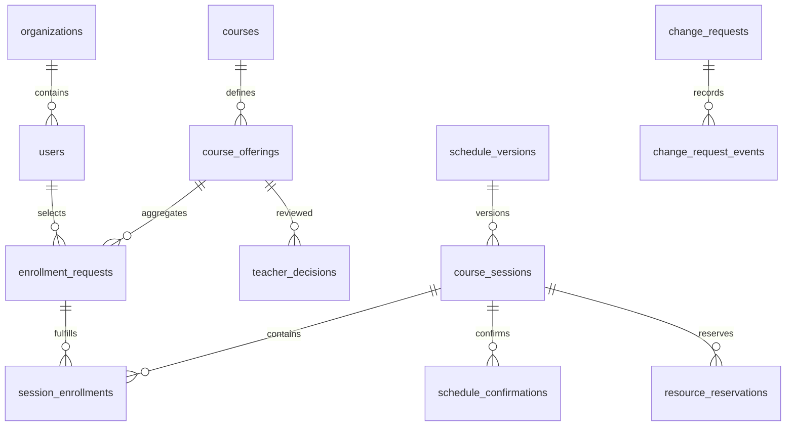

# 数据库

PostgreSQL 16，33 张业务表及 Alembic 版本表。采用代理主键、机构作用域、版本号、审计字段及机构复合外键。

| 领域 | 表 |
|---|---|
| 身份 | organizations, users, student_profiles, teacher_profiles, auth_sessions, account_tokens |
| 资源 | courses, course_features, teacher_qualifications, rooms, room_features |
| 时间 | time_slot_templates, availability_rules, availability_exceptions |
| 需求审核 | course_offerings, enrollment_requests, enrollment_time_preferences, teacher_decisions, offering_slots |
| 课表 | schedule_versions, course_sessions, session_enrollments, schedule_confirmations, resource_reservations |
| 工作流运营 | change_requests, change_request_events, notifications, outbox_events, attendance_records, course_feedback, audit_logs, solve_jobs, idempotency_records |

每学生、课程、周最多一条需求；取消或请假后重新申请复用记录并重新审核。每机构每周最多一个待确认、一个 ACTIVE 版本。确认、通知、Outbox、幂等请求具有唯一约束。

资源使用 TSTZRANGE 半开区间，按机构、类型、ID 和重叠时间建立 GiST 排他约束，依赖 btree_gist。事件使用数据库递增序号，避免同事务相同时间戳乱序。

0001 固定初始结构，0002 添加事件序号，0003 增加入口会话与一次性账号凭证并撤销旧会话，0004 增加账号凭证幂等字段。后续编写新迁移，不读取运行时模型重建历史迁移。

本次全天覆盖开关 `require_full_day_coverage` 保存在机构规则和课表输入 JSON 快照，不改变表结构。新机构/新候选启用；历史快照缺失字段按原规则读取，不能直接按新版发布。完成任务删除候选时解除 `solve_jobs.version_id` 关联，保留精简结果；只删除该未发布版本的课次、成员和输入快照，删除审计与幂等记录保留。存在业务引用或发布历史则拒绝删除，不对历史表做无条件级联清理。

数据库卷 eduflow-ai_postgres_data。DataGrip 连接 127.0.0.1:5432，凭证取本地 .env；原 DataGrip 工作目录为 IDE 配置，并非数据库存储。

## 账号与权限迁移

AuthSession.portal 保存 ADMIN / PUBLIC 等用途，旧 LEGACY 会话升级后撤销；访问 JWT 绑定同一用途与 audience。AccountToken 保存用户、INVITE / RESET、凭证摘要、过期和使用时间，以及发起者、幂等键和请求指纹；机构/用户复合外键和唯一约束防止跨机构关联及重复请求。

一次性凭证仅在管理员操作时返回，数据库不保存原始链接。接受凭证时在事务中锁定账号和凭证，使用后撤销原会话与其他未用凭证。改密与停用同样使旧会话失效。

默认容器使用非超级用户 DML 角色；迁移和新库恢复通过单独维护凭据。列表分页 count / limit / offset 在 SQL 执行，求解快照不复用分页结果。加密备份、恢复及迁移测试使用独立 *_test 库，保留主库及原卷。
