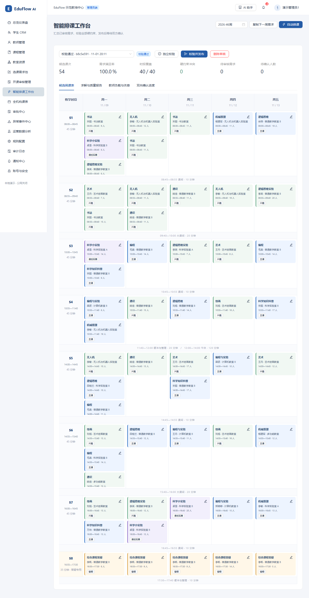
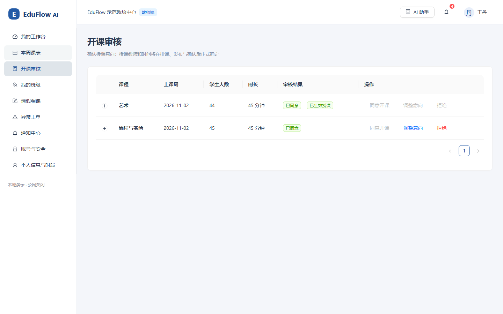
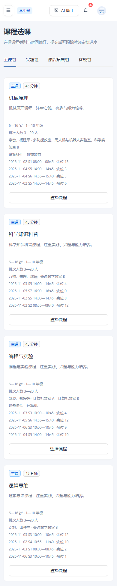

# EduFlow 作品展示

本版本为单机构、本机自托管的教培 CRM 与智能排课系统。以下截图全部来自固定种子的合成数据，未使用真实师生或个人电脑界面。公网默认关闭，手机页面由浏览器设备模拟验证。

## 演示主线

学生在师生入口选择课程与意向时段，教师审核授课意向；管理员生成 CP-SAT 候选方案、查看独立校验报告并发布；师生按课次确认，必要确认收齐后整周原子生效。S7 调整通过异常工单、真实求解和审批，只重新收集受影响课次确认；出勤和反馈在课程结束后保存。

管理员使用本机 8000，教师/学生使用 8100。完整步骤及账号见 [使用说明](user-guide.md)，实际成绩与限制见 [测试报告](testing-report.md)。

## 三端界面

管理员全天周课表：统一时间、大课间、午休、S8 答疑及课程分类，每工作日八个时段都有真实班次。此图为上一轮验收保留的候选界面，用于展示校验和删除草稿操作；作品集另附 68 课次生效版的分析，不用历史截图核对现值。

教师审核：查看课程与人数、审核意见和生效保护；窄屏表格在内部横向滚动。

学生课程：390 宽度的合成数据页面，展示实际班次、余位与中文设备要求。

## 工程内容

React/TypeScript/Ant Design 双构建，FastAPI 模块化单体、领域端口、PostgreSQL 事务与资源排他约束、Redis/Celery、Outbox、离线 Agent 与 OR-Tools。容器只绑定回环地址，师生应用无管理 API，采用独立令牌用途、密钥与 Cookie。

三端共享课程与课表状态，分别校验管理员、教师、学生的角色和数据范围。 [架构](architecture.md) · [使用手册](user-guide.md)

单周合成数据包含 220 名学生、668 条已安排需求、68 个生效课次和 736 项模拟确认。首页对比展示偏好提升与额外开班的资源取舍。 [五页分析报告](portfolio/EduFlow-Case-Study.pdf) · [交互与对账](../analytics/README.md)

功能、数据和独立部署的检查范围见 [本地验收结果](testing-report.md)。
